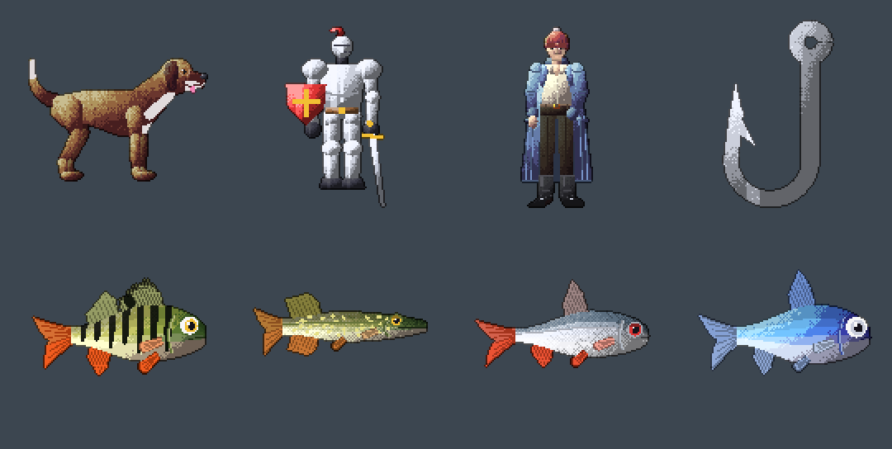
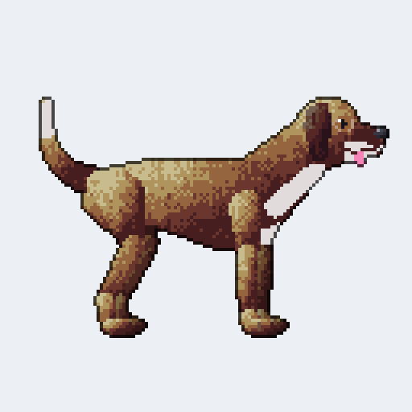
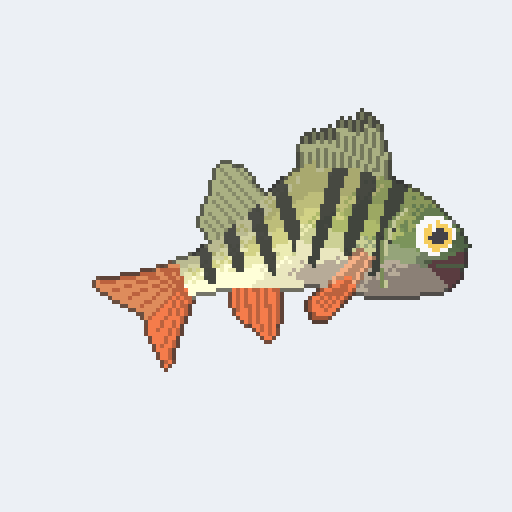
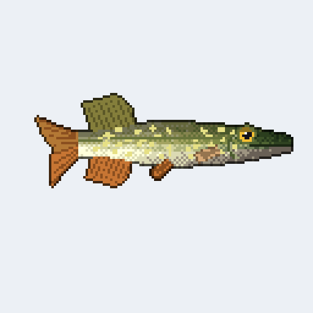
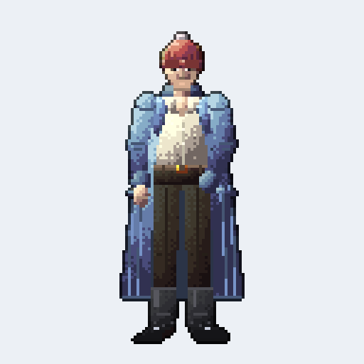
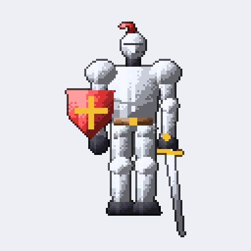
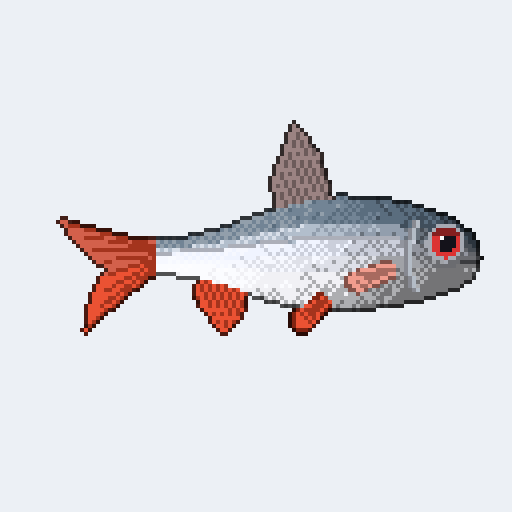
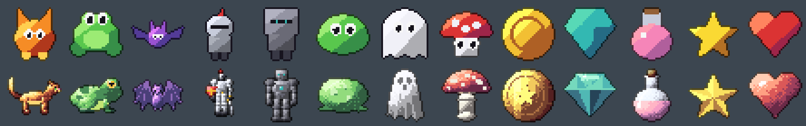
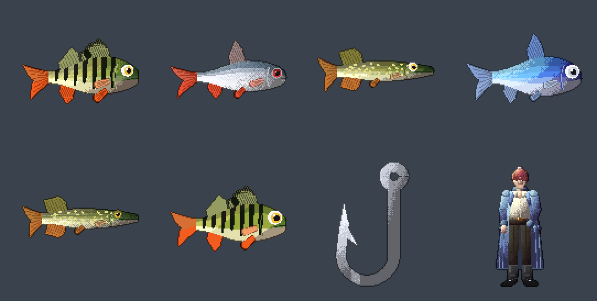
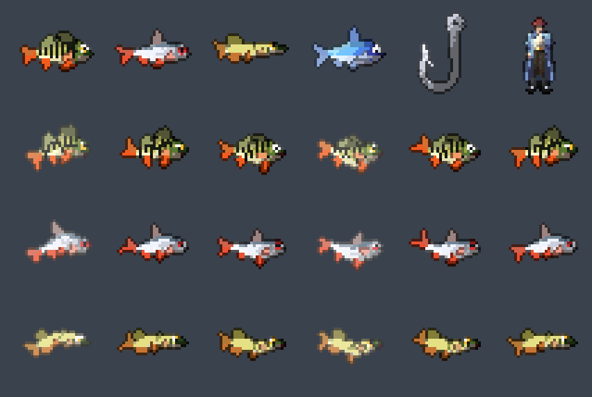

# Piksu

**Describe a sprite in a sentence. Get pixel art and animation frames back.**

It feels like prompting an image model, but it behaves like a compiler:
- the same sentence and the same `rules.toml` always give the same pixels;
- every choice can be traced to the words that asked for it;
- a sprite that fails its checks isn't written at all.

No neural network runs at generation time.



Every sprite above is Piksu's output for one sentence, the first frame of its animation:
"a happy brown dog, walking", "a realistic knight, walking", "an ice fisherman, walking",
"a silver hook", "a perch, swimming", "a realistic pike, swimming", "a roach, swimming" and
"a fish, swimming". They are 128 x 128, shown at 2x. Nothing is drawn by hand or touched up
afterwards.

## Animated

| `a happy brown dog, walking` | `a perch, struggling` | `a realistic pike, swimming` |
|:---:|:---:|:---:|
|  |  |  |
| **`an ice fisherman, walking`** | **`a realistic knight, walking`** | **`a roach, swimming`** |
|  |  |  |

Each animation is a seamless loop. A struggling fish swings from its mouth, bends one way and
then the other, and its tail whips twice per bend. Walking moves the legs, and the frames are
checked for smooth motion, including the last frame back to the first.

## One word changes the style



The same thirteen requests: a cat, a frog, a bat, a knight, a robot, a slime, a ghost, a
mushroom, a coin, a gem, a potion, a star and a heart. Above, `cartoon`; below, `realistic`.
Realism is one of the decisions the sentence steers. It changes the anatomy, the shading, the
palette ramps and how much detail is drawn.

## From a sentence to a sprite

```
$ piksu "a small green slime with big eyes, bouncing"
a small green slime with big eyes, bouncing -> out/slime_bounce (12px, 8 frames)
  body               body/round (the slime)
  colour             "green slime"
  eyes               eyes/shine
  ...
```

Piksu is a [HotMotor](https://github.com/Joosehot/HotMotor) engine, like FeelRight, Senne
and Aras: a closed lexicon, a parser, one rule per decision, beam search with judges, and
checks that refuse a bad result.

## The pipeline

| step | file | what it does |
|---|---|---|
| lexicon | `src/lexicon.rs` | a closed vocabulary; an unknown word is an error with a "did you mean" hint (`--lenient` skips it) |
| parser | `src/parser.rs` | the sentence becomes a request: subject, size, colours, features, animations, frames, mood, style; each value keeps its words; an unused value is an error ("4 what?") |
| rules | `src/rules/*.rs` | one decision per file with variants: realism (cartoon / stylized / realistic), body (round / tall / wide), palette (hue-shifted / value-only ramp), shading (flat / top light / rim / lit), outline (dark / coloured / none), eyes (dot / shine / angry / sleepy / visor), mouth (none / smile / open / fangs), timing (linear / eased / snappy) |
| search | `src/search.rs` | beam search; a variant scores `weight * (1 + axes . (profile - 0.5))` on [cute, readable, detail]; words like "cute", "spooky", "simple", "detailed" shift the profile; judges score combinations (no outline on a tiny canvas, shiny eyes and a smile for "cute", ...) |
| figure | `src/figure.rs` | the chosen design as coloured parts: body, eyes, mouth, and features (horns, ears, wings, crown, hat, antenna, tail, spots, stripes) |
| fish | `src/fish.rs` | fish and hooks seen from the side at every realism level: one blueprint, more detail the more realistic (fin rays, lateral line, scales) |
| animation | `src/anim.rs` | idle, bounce (squash and stretch), walk (legs), fly (wing flaps), spin, float, blink, hurt (flash and shake), swim and struggle (fish), as one seamless loop |
| fit + render | `src/lib.rs`, `src/render.rs` | the figure, with all its motion, is fitted into the canvas with room for the outline, then rasterised pixel by pixel (no anti-aliasing), shaded and outlined |
| checks | `src/checks.rs` | fits the canvas, no stray pixels, readable coverage, outline and eye contrast, smooth motion between frames (shape change and step size, including last to first), symmetry |

Finalists differ in body, eyes and outline, so when one fails a check, the next is a real
alternative. If none pass, Piksu says why and writes nothing:

```
$ piksu "a tiny pink heart, spinning"
error: no design passed the checks
  hint: spin frame 4 is empty
```

Every number (proportions, palette shifts, animation amplitudes, judge weights, check limits)
lives in `rules.toml`. Point `--rules` at a copy to change the taste.

## What it knows (v0)

- **People:** "a human" (man, woman, person, cowboy...) is drawn from the front with real
  anatomy at every realism level. Clothes are features coloured by the sentence: hair, coat,
  shirt, trousers, boots, belt, and a claw arm. Named characters live in rules.toml
  `[characters]`: `piksu "Winston Black, walking"`.

- **Subjects:** slime, ghost, bat, cat, dog, frog, knight, robot, coin, gem, star, heart, potion,
  mushroom, human, fish, perch, roach, pike, hook and lure. A dog and a human are always drawn with real
  anatomy.
- **Fish** (for an ice-fishing game): Finnish lake fish seen from the side, facing right. A perch
  (ahven) is green-yellow with dark bars, red-orange fins and a spiny first dorsal fin with a black
  blotch; a roach (särki) is silver with red eyes and reddish fins; a pike (hauki) is long and slim,
  olive with rows of pale spots, a long flat snout and its dorsal and anal fins far back; "a fish"
  is a plain blue one. Proportions are in `[anatomy.<fish>]`, colours and markings in
  `[fish.<fish>]`. `swimming` sweeps the tail, bends the rear of the body and paddles the fins;
  `struggling` (thrashing, hooked) is a 6-frame loop for a fish fighting the hook: it swings from
  its gaping mouth, bends hard one way then the other, the tail whips twice per bend and the two
  hardest pulls flash; idle is a gentle swim in place; hurt flashes and shakes. "a silver hook" is a fishing hook, and "an ice
  fisherman" is a person in a bobble hat, a long winter coat and boots (`[characters]`).
  "a tiny silver lure fish" (a jig, pilkki) is a small polished metal fish threaded on a hook;
  a hook and a jig hang from the hook's eye, point up, and are drawn with the eye at the centre
  of the canvas, so a game hangs them by their middle. `fluttering` (jigging) rocks a jig around
  its eye as it sinks after a twitch, flashing at the steepest tilt.
- **Sitting:** "sitting" draws a person from the side, facing right, on a small weathered box,
  the near hand held forward (where a rod goes): the upper body breathes when idle, the seat and
  feet stay put. Cold-weather clothes go with it: a parka of skins with a trimmed hem, its hood
  up and a fur ruff framing the face, mittens and kamik (soft skin boots with a pale top band).
  "an Inuit ice fisher" (or "an Inuk ice fisher") is such a person (`[characters]`), proportions
  in `[anatomy.sitter]`.
   
- **Colours:** red, orange, yellow, green, blue, purple, pink, black, white, grey, brown, gold,
  silver and teal, each optionally light or dark. A colour before a feature colours that feature
  ("red eyes", "a gold crown").
- **Features:** big / small / one eye, angry, sleepy, happy, fangs, horns, ears, wings, crown,
  hat, antenna, tail, spots and stripes; a person also takes a winter hat (beanie).
- **Animations:** idle, bouncing, walking, flying, spinning, floating, blinking, hurt, swimming,
  struggling and fluttering.
  "6 frames" sets the count. A slime can't walk and a coin doesn't fly; you get an error instead
  of a guess.
- **Sizes:** 128 x 128 is the baseline (a face, a coat's folds and a claw's scales get several
  pixels each). Tiny, small, medium, big, large and huge, or "24x24" / "24 pixels", ask for less.
- **Style:** outlined, "no outline", flat or shaded. Mood words: cute, spooky, simple and detailed.
- **Realism:** "cartoon" (flat colour, big eyes), "stylized" (directional light in several tones)
  or "realistic". Realistic is real anatomy, not just light (`src/anatomy.rs`, numbers in
  `[anatomy.*]`): animals in side view (a cat on four jointed legs with a diagonal-pair walk, slit
  pupils and an S tail; a crouched frog with folded hind legs and an eardrum; a bat with forearm,
  finger bones and a membrane between them), people and robots at about six and a half heads tall
  with knees, elbows and a front-view walk (a knight with a visored helm, sword and kite shield),
  and objects as they are built (a fly agaric with gills and a ring, a coin turned to show its
  milled edge and relief, a brilliant-cut gem, a glass flask with liquid). On top: light in five
  tones with dithered edges and material texture. Judges
  keep it honest: realism wants directional light, a selective outline and at least 16 pixels.

`piksu --vocabulary` lists every word.

## Output

`out/<subject>_<animation>/` (or `-o DIR`):

- `sheet.png` has one row per animation.
- `preview.png` is the same sheet enlarged to about 512 pixels.
- `frames/*.png` holds each frame, and `<animation>.gif` is an animated preview.
- `droid/*.txt` holds Droid text sprites (a palette, `---`, then pixel rows), ready for a Droid game's `sprites/`.
- In a game: load `frames/<animation>_<i>.png` (each `size` x `size`, transparent background,
  frames 0..n-1 of a seamless loop), or cut `sheet.png`: row r is the r-th animation, frame c sits
  at x = 1 + c * (size + 1), y = 1 + r * (size + 1) (1-pixel padding, `[output] sheet_padding`).
- `why.txt` maps every piece to the rule and variant that made it and the words that asked for it.
- `sentence.txt` holds the input.

## Proof

`cargo test`:
- unit tests: lexicon, parser, colour math, shapes, animation loops, and one test where each
  rule applies and one where it doesn't, plus the judges
- `tests/golden.rs`: every sentence in `examples/*.txt` is made several times and must be
  byte-identical and match `examples/out/` (`PIKSU_BLESS=1 cargo test` accepts intended changes);
  honest failures and a rules.toml typo are tested too

## Install

```
git clone https://github.com/Joosehot/Piksu
cd Piksu
cargo run --release -- "a cute orange cat, walking"
```

## License

MIT, see [LICENSE](LICENSE).
